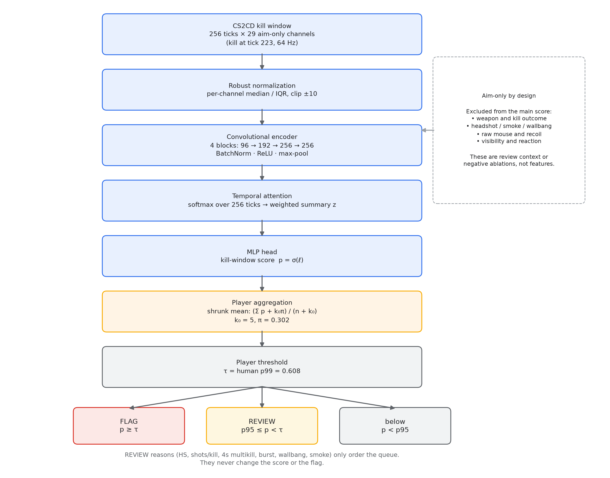
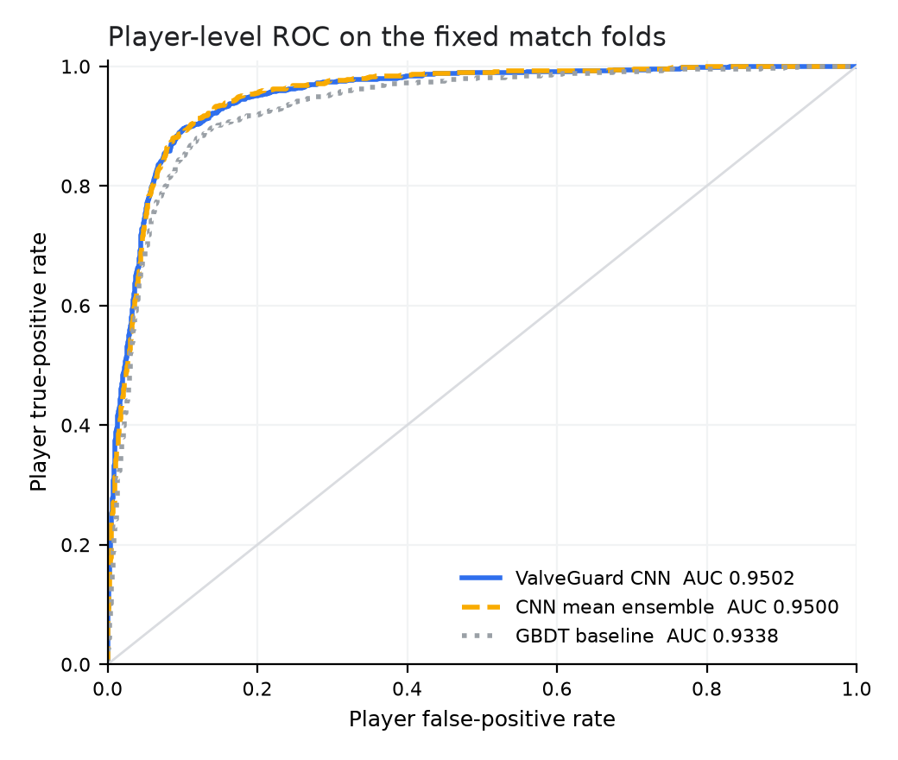
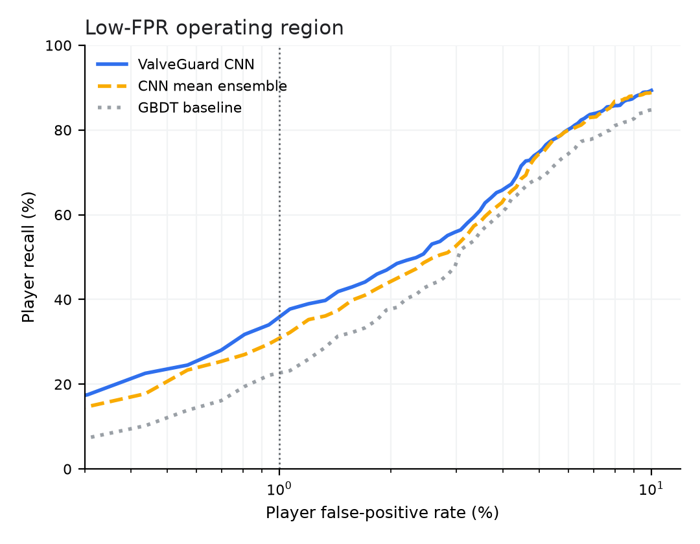
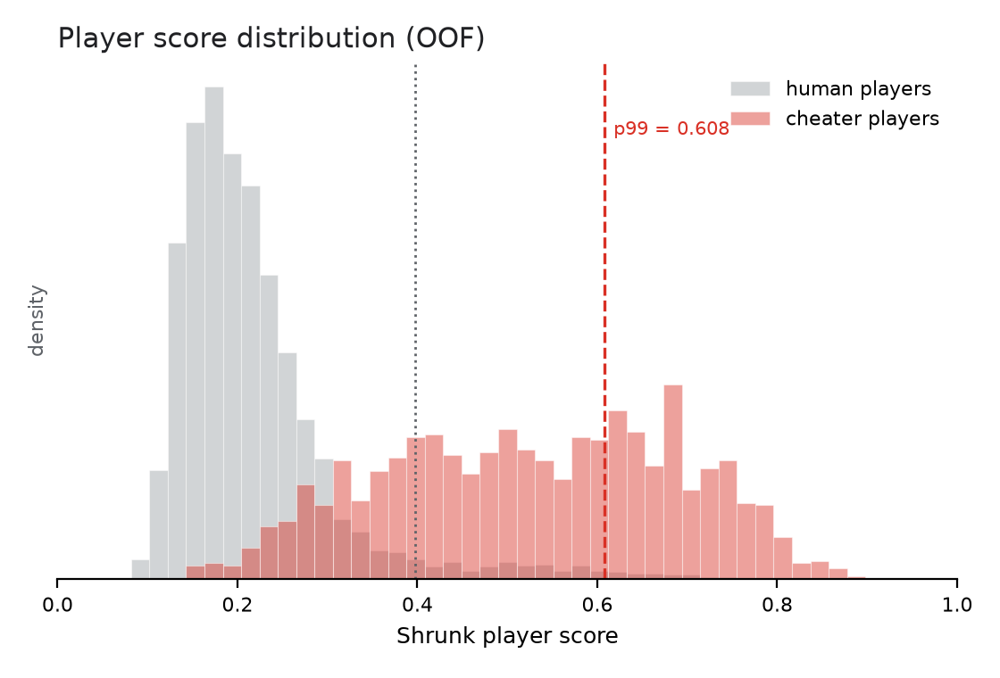
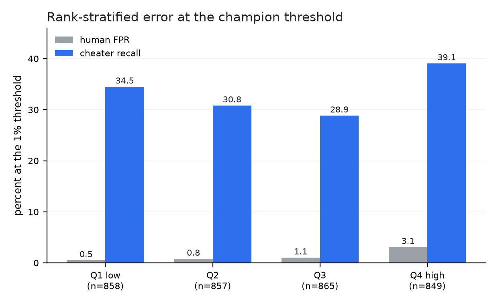
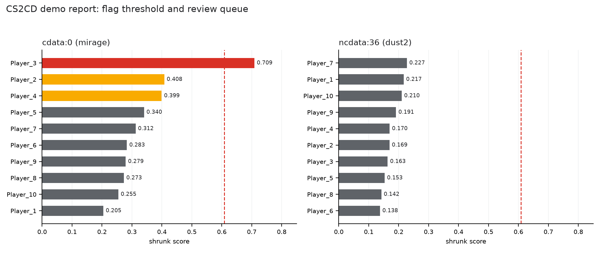
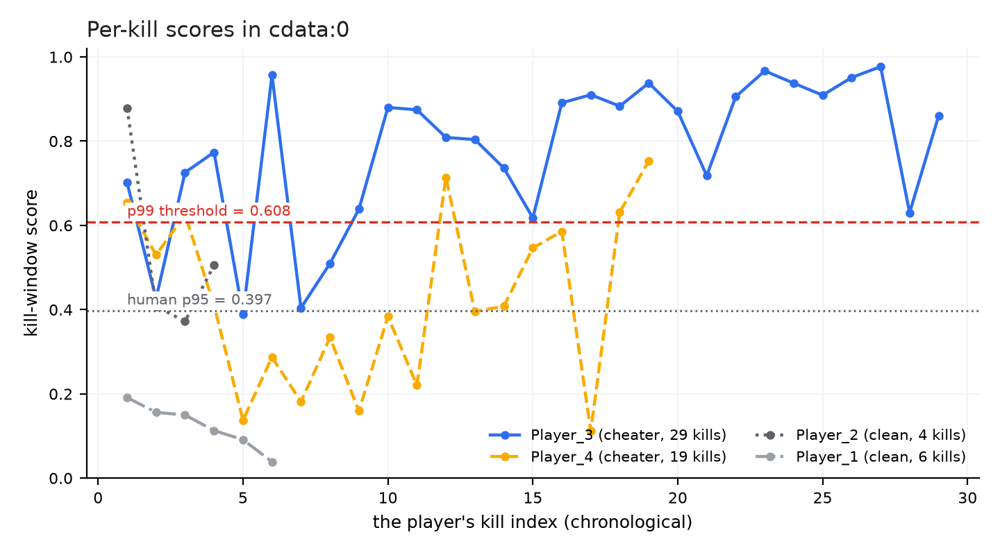
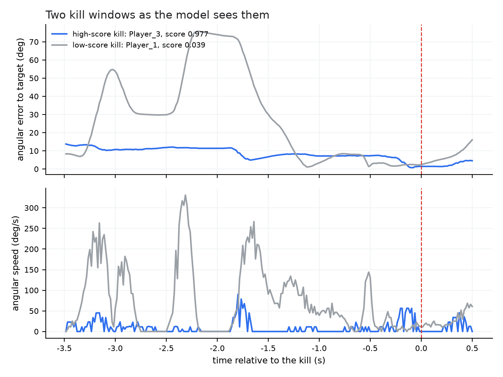

# ValveGuard: Detecting Aim Assist in CS2 from Kill-Centred View Trajectories

**Author**: ValveGuard Project  
**Affiliation**: Independent research project  
**Date**: 2026-10-20  
**Version**: v1.0 (final draft)

> Chinese version: [valveguard-paper-zh.md](valveguard-paper-zh.md)

## Abstract

The most useful evidence of aim assist in Counter-Strike 2 (CS2) is not the kill outcome but the view trajectory in the few hundred milliseconds around the kill: how the crosshair approaches the target, when it decelerates, whether it overshoots and corrects, and whether it stays locked while the target moves. We present a reproducible, server-side demo-only detector. From the CS2CD 256-tick kill windows we extract 29 aim-only channels, encode the trajectory with a wide convolutional network and temporal attention, train with a hard-negative weighted BCE loss, and convert kill scores into a player-level risk score with empirical-Bayes shrinkage.

On a fixed five-fold match-disjoint split, the final model (three seeds × five folds, α=5) reaches player-level AUC **0.9502**, recall at 1% FPR **0.3619**, Q4-player FPR **3.11%**, Q4 recall **39.1%**, and kill-level AUC **0.9015**. Against a GBDT baseline, the match-grouped paired bootstrap gives a mean recall gain of **+0.1223** (95% CI [0.0476, 0.1988]), an AUC gain of **+0.0165** ([0.0120, 0.0211]), and a Q4 FPR change of +0.0030 ([-0.0090, 0.0161]). Against a same-architecture three-seed ensemble without hard-negative weighting, the recall gain is **+0.0459** ([0.0048, 0.0883]) with essentially unchanged AUC.

We also report a series of negative results. Raw mouse/recoil channels, visibility/reaction channels, player-level MIL, behavioural outcome fusion, and top-k aggregation do not reliably beat the current design at low FPR. The processed XGUARDIAN data suffers from a severe window-count confound and cannot serve as a fair external validation set. Finally, we package the model as a checksummed artifact and implement a CS2CD-backed demo report with a human review queue. Behavioural reasons only order the queue; they never change the risk score or the FLAG.

**Keywords**: CS2; aim-assist detection; view trajectories; low false-positive rate; hard negatives; player aggregation; reviewable evidence

## 1 Introduction

Aim assist in first-person shooters such as Counter-Strike 2 (CS2) [5] modifies crosshair motion to make aiming closer to the target. Unlike wallhacks or information sharing, its core evidence lies in **aiming dynamics**. Human aim contains acceleration, deceleration, overshoot, and correction, shaped by target distance, lateral target speed, weapon, and sensitivity. Aim assist may instead appear as unusually smooth motion, unusually early deceleration, excessive target locking, or a lack of human-like correction when the target changes direction.

Server-side CS2 demos record player positions, view angles, weapons, and health at roughly 64 Hz, but do not contain 1000 Hz raw mouse input. The available signal is therefore the **view-angle trajectory**, not the full mouse trajectory. This limits the visibility of high-frequency tremor and forces the detector to work at a relatively low sampling rate.

The goal of this work is not an automatic ban system but a **risk ranker for human review**. This imposes three design constraints:

1. **Low false-positive rate first.** We evaluate at a player-level 1% FPR operating point rather than reporting accuracy or full AUC alone.
2. **Aim information only.** Weapons, kill outcomes, headshots, smoke, and similar metadata can become dataset shortcuts and must not drive the main score.
3. **Reviewable output.** Each player needs a score, a percentile, kill-window evidence, and behavioural context so an analyst can decide whether to look further.

Our contributions are:

- A complete, reproducible pipeline from CS2CD windows to a deployable artifact, including coordinate denormalization, pitch-sign correction, 29 aim-only channels, and per-seed normalization.
- A wide convolutional window model with temporal attention and a hard-negative weighted BCE loss for low FPR; it improves significantly over both GBDT and a plain CNN ensemble on the same fixed folds.
- A player-level empirical-Bayes shrinkage and threshold protocol, together with a match-grouped paired bootstrap for evaluation.
- A dataset-backed demo system that needs no external demo: it generates reports, charts, and a review queue directly from CS2CD match windows.
- Systematic negative results for raw mouse, visibility, player-level MIL, and behavioural fusion, showing that “aim-only plus hard negatives” is the more reliable route under the current data conditions.

## 2 Related Work

**XGuardian** is the closest prior work on server-side CS2 aim-assist detection. It uses pitch/yaw trajectories in elimination windows and reports high accuracy with a low FPR. We differ in our emphasis on the player-level 1% FPR operating point, a reproducible fixed-fold protocol, a human review queue, and an explicit audit of confounding in external data.

**GAN-Aimbots** studies conditional GANs that generate human-like aim and evaluates detectors against them. It shows that “human-like vs. not human-like” can be a detection signal, while also highlighting the generator–detector arms race. We do not generate trajectories; we work strictly on the defensive detection side.

**HAWK** builds an anti-cheat framework around human behaviour modelling, behavioural consistency, and explainability. Our behavioural context (headshot rate, multikills, burst, kill gaps) is related in spirit, but we restrict behavioural information to the review-ordering layer; it never enters the risk score.

**CS2CD** provides the CS2 dataset used here. CS2CD windows are kill-centred and labelled from VAC bans and manual review. Non-cheater labels inside cheater matches have limited precision, so we use only clean negatives; see Section 3.

Compared with the above, our position is a **reproducible, low-FPR, explainable, and demonstrable baseline on public data**, together with an honest account of which directions did not work.

## 3 Data

### 3.1 CS2CD kill windows

We use CS2CD `Context_window_256`; statistics are in Table 1:

**Table 1**: CS2CD `Context_window_256` dataset statistics.

| Item | Value |
|---|---|
| Unaugmented windows | 90,707 |
| Matches | 794 |
| Cheater / non-cheater windows | 18,423 / 72,284 |
| Clean training and evaluation windows | 79,533 |
| Matches / players in the clean cohort | 793 / 5,868 |
| Matches with a cheater | 316 |
| Clean-only matches | 478 |
| Window shape | 256 × 44 |
| Kill row | 223 (223 ticks before, 32 after) |
| Sampling rate | 64 Hz |

Labels come from the directory (`cheater/` or `not_cheater/`). File names have the form
`cdata-cheater-file_{match}-Player_{k}-kill_{i}.parquet`, where `Player_{k}` is a **per-match pseudonym**, not a stable SteamID. Evaluation is therefore match-disjoint, not person-disjoint.

### 3.2 Label cleaning

Non-cheater windows from cheater-present matches (`cdata` with `label=0`) have limited label precision; the dataset card estimates about 55.6%. We exclude all of them and keep 79,533 clean windows. We audited the exclusion at the window level: the excluded windows score like clean humans, with an estimated cheater admixture of about 5.5% by a first-moment decomposition, which does not support the 55.6% figure. Details are in `label-noise-audit.md`. Regardless of the audit, excluding them is the conservative choice.

### 3.3 Demonstration matches

The demo uses no external demos; it reads two matches directly from the dataset cache:

- `cdata:0`: Mirage, 78 kill windows, 10 players, with cheater labels for `Player_3` and `Player_4`.
- `ncdata:36`: Dust2, 232 kill windows, 10 players, all clean.

These matches are used only to show the report and queue shape. They overlap the artifact's training folds and are not generalisation metrics.

## 4 Method

### 4.1 Preprocessing and channels

For a 256-tick window, let $x_{t,c}$ be channel $c$ at tick $t$. We first denormalize the published coordinates to map space:

$$
X = X_{\min} + \tilde{X}(X_{\max}-X_{\min}),
$$

where $X_{\min}, X_{\max}$ come from the map-bounds table. View angles are recovered as

$$
\theta_{\text{stored}} = 180\tilde{\theta}-90,\qquad
\psi_{\text{stored}} = 360\tilde{\psi}-180,
$$

where $\theta$ is pitch and $\psi$ is yaw.

CS2's stored pitch is opposite to the geometric expectation. For target-relative displacement $(\Delta x,\Delta y,\Delta z)$, define

$$
\theta_{\text{target}} = -\arctan\!\frac{\Delta z}{\sqrt{\Delta x^2+\Delta y^2}},
$$

so the pitch error is

$$
e_{\theta} = \theta_{\text{stored}}-\theta_{\text{target}}.
$$

On a sample kill tick this sign convention reduces the origin-relative error from 6.38° to 0.24°. The head error uses the same construction with an eye-height correction.

The input is 29 **aim-only** channels in five groups:

| Group | Channels |
|---|---|
| Position and velocity | `attacker_X/Y/Z`, `attacker_vel`, `attacker_pitch`, `attacker_yaw`, `victim_X/Y/Z`, `victim_health`, `victim_noise` |
| Angular velocity and higher-order dynamics | `dyaw_dps`, `dpitch_dps`, `speed_dps`, `accel_dps2`, `jerk_dps3` |
| Target-relative error | `err_yaw`, `err_pitch`, `err_pitch_head`, `err_origin`, `err_head` |
| Distance and geometry | `dist_norm`, `dist`, `dist_rate` |
| Locking and relative motion | `expected_yaw_vel`, `actual_yaw_vel`, `victim_speed`, `attacker_speed`, `t_norm` |

Weapon, headshot, smoke, wallbang, midair, raw mouse, and visibility channels are **not** in the main model. They either create label shortcuts or provide no stable gain at 64 Hz; see Section 5.3.

Each channel is robustly normalized with the training median and IQR:

$$
\tilde{x}_{t,c}=\operatorname{clip}\!\left(\frac{x_{t,c}-m_c}{s_c},-10,10\right),
$$

where $m_c$ is the median, $s_c=Q_{75,c}-Q_{25,c}$, and $s_c$ is set to 1 if it is below $10^{-6}$. Normalization parameters are stored per seed, and channels are selected by name at inference time to avoid column-order drift.

### 4.2 Architecture

The input is $X\in\mathbb{R}^{256\times 29}$. After transposing to $29\times256$, four one-dimensional convolution blocks produce

$$
29 \to 96 \to 192 \to 256 \to 256,
$$

with kernel sizes 7, 5, 3, and 3. Each block has BatchNorm and ReLU; the first two are followed by $2\times$ max pooling. The resulting time representation is

$$
H=[h_1,\dots,h_T]\in\mathbb{R}^{T\times256}.
$$

Temporal attention computes

$$
e_t=w_2^\top\tanh(W_1h_t),\qquad
a_t=\frac{\exp(e_t)}{\sum_{t'}\exp(e_{t'})},\qquad
z=\sum_{t=1}^{T}a_th_t.
$$

A two-layer MLP produces the kill-window logit:

$$
\ell=\mathrm{MLP}(z),\qquad p=\sigma(\ell).
$$

The model has **524,162** parameters. Figure 1 shows the full pipeline.

<p align="center">
  
</p>

**Figure 1**: ValveGuard inference pipeline. The left column encodes the window and aggregates player scores; the side panel lists the channels deliberately excluded from the main score. Behavioural context only orders the review queue and never enters the score.

### 4.3 Hard-negative weighted BCE

Negatives far outnumber positives. Let $N_-,N_+$ be the number of negatives and positives in a training fold. The positive class weight is

$$
w_{\text{pos}}=\frac{N_-}{N_+}.
$$

For window $i$, the base binary cross-entropy is

$$
\ell_i=-\left[w_{\text{pos}}y_i\log p_i+(1-y_i)\log(1-p_i)\right].
$$

Low FPR is governed by the **upper tail** of the human score distribution: a clean window that the model scores highly is more costly than a low-scoring clean window. We therefore multiply the negative term by a prediction-dependent weight:

$$
h_i=
\begin{cases}
1, & y_i=1,\\
1+\alpha\,\big(\sigma(\ell_i)\big)^2, & y_i=0,
\end{cases}
$$

where $\sigma(\ell_i)$ is detached from the gradient so that the loss cannot trivially collapse negative scores toward zero. The final loss is

$$
\mathcal{L}=\frac{\sum_i h_i\ell_i}{\sum_i h_i}.
$$

The main experiment uses $\alpha=5$. We compared $\alpha\in\{2,5,10\}$: $\alpha=10$ gives a slightly higher single-seed recall (0.3479 vs. 0.3440), but the gain is small and the setting is more aggressive, so we keep $\alpha=5$. This is related to online hard example mining [9] and focal loss [10], but our weight acts only on negatives and is based on the current prediction rather than a fixed hard set.

### 4.4 Player aggregation

For player $i$ with $n_i$ kill windows and scores $s_{i,j}=\sigma(\ell_{i,j})$, the raw mean is too noisy for players with only two or three kills. We use empirical-Bayes shrinkage:

$$
\hat{s}_i=\frac{\sum_{j=1}^{n_i}s_{i,j}+k_0\pi}{n_i+k_0},
$$

with $k_0=5$ and prior $\pi=0.3018746$ (the mean score of training human players). A small $n_i$ pulls the score toward the prior; a large $n_i$ approaches the player's own mean.

The threshold is the 99th percentile of out-of-fold human player scores:

$$
\tau=Q_{0.99}\big(\{\hat{s}_i:y_i=0\}\big)=0.608027.
$$

A player is FLAG if $\hat{s}_i\ge\tau$, REVIEW if $\hat{s}_i$ lies between the human p95 and p99, and below otherwise. REVIEW is a human-review band, not a detection decision.

### 4.5 Metrics and statistics

Player-level metrics are primary; kill-level metrics are secondary:

- Player AUC: ranking cheater vs. clean players by player score.
- Recall@FPR=1%: cheater recall at the threshold that gives 1% FPR on clean players.
- Q4 FPR: fraction of clean players in the top rank quartile above the threshold.
- Q4 recall: fraction of cheater players in the top rank quartile above the threshold.
- Kill AUC: window-level ranking ability.

FPR and recall are

$$
\mathrm{FPR}(t)=\frac{1}{N_-}\sum_{i:y_i=0}\mathbf{1}[\hat{s}_i\ge t],\qquad
\mathrm{Recall}(t)=\frac{1}{N_+}\sum_{i:y_i=1}\mathbf{1}[\hat{s}_i\ge t].
$$

All models use the same fixed five-fold match split (from `reports/cv_gbdt/cv_predictions.parquet`); no match appears in two folds. The three seeds share the folds. ROC/AUC follow [7]. Model comparisons use a **match-grouped paired bootstrap** [6]: matches are resampled with replacement 500 times, both models are re-scored on each replicate, and we report the mean and 95% percentile interval of the difference. This preserves the correlation among players in the same match.

## 5 Experiments

### 5.1 Baselines

- **GBDT**: 59 handcrafted window features, `HistGradientBoostingClassifier` with 300 trees, 31 leaves, learning rate 0.05, and L2=1.0. This is the strong early baseline.
- **Plain CNN ensemble**: the same 29 channels and folds, three seeds × five folds, but without hard-negative weighting.
- **ValveGuard CNN**: 29 channels, wide convolution with temporal attention, three seeds × five folds, $\alpha=5$. This is the final model.

### 5.2 Main results

Main results are in Table 2.

**Table 2**: Main results on the fixed five-fold match split.

| Model | Kill AUC | Player AUC | Recall@FPR=1% | Q4 FPR | Q4 Recall |
|---|---|---|---|---|---|
| GBDT | 0.8497 | 0.9338 | 0.2296 | **2.59%** | 22.9% |
| CNN mean ensemble | **0.9021** | 0.9500 | 0.3121 | **2.59%** | 33.9% |
| **ValveGuard CNN** | 0.9015 | **0.9502** | **0.3619** | 3.11% | **39.1%** |

Paired bootstrap:

- ValveGuard vs. GBDT: $\Delta$kill AUC **+0.0519** [0.0470, 0.0568]; $\Delta$player AUC **+0.0165** [0.0120, 0.0211]; $\Delta$recall **+0.1223** [0.0476, 0.1988]; $\Delta$Q4 FPR +0.0030 [-0.0090, 0.0161].
- ValveGuard vs. mean ensemble: $\Delta$recall **+0.0459** [0.0048, 0.0883]; $\Delta$AUC +0.0002 [-0.0014, 0.0016]; $\Delta$Q4 FPR +0.0048 [-0.0057, 0.0158].

The table reports full-OOF point estimates; the bootstrap reports the mean of the resampled differences, so it can differ slightly from the direct difference of the two point estimates. The hard-negative gain in recall is significant, with no material AUC change. Q4 FPR rises from 2.59% to 3.11%, which is about two extra false positives among 386 clean Q4 players; the interval crosses zero. In exchange, Q4 recall rises from 33.9% to 39.1%. Under a human-review deployment this trade-off is reasonable; under automatic banning it would not be.

<p align="center">
  
</p>

**Figure 2**: Player-level ROC. All curves use the same fixed folds and shrinkage aggregation.

<p align="center">
  
</p>

**Figure 3**: The low-FPR region. The horizontal axis is player FPR on a log scale; the dotted line marks 1%.

<p align="center">
  
</p>

**Figure 4**: Player score distribution and the human p99 threshold. Red is cheaters, gray is clean players.

<p align="center">
  
</p>

**Figure 5**: Error by rank quartile. The clean-player FPR in Q4 is 3.1%, well above the 0.5%–1.1% of lower quartiles.

### 5.3 Ablations and negative results

Ablations and negative results are in Table 3.

**Table 3**: Ablations and negative results. Raw and visibility channels are evaluated on their covered subsets and are not directly comparable to the main table.

| Variant | Player AUC | Recall@FPR=1% | Q4 FPR | Outcome |
|---|---|---|---|---|
| Top-5 aggregation | 0.9277 | 0.3230 | 3.37% | Slight recall gain; worse AUC and Q4 FPR; not default |
| Player MIL (frozen encoder) | 0.9478 | 0.3175 | 5.44% | Q4 FPR substantially worse; rejected |
| Player MIL (unfrozen) | 0.9329 | 0.2856 | 3.63% | AUC drop; rejected |
| 29 + 23 raw channels | 0.9387 | 0.2770 | -- | Kill AUC only +0.0037; no player-level gain |
| 29 + 5 visibility/reaction channels | 0.9461 | 0.3136 | 3.13% | Kill AUC +0.0074; no player-level gain |
| Behaviour-only score | 0.9196 | 0.1572 | 2.85% | Low-FPR tail is not cheat-specific |
| Behaviour rank fusion 0.75 | 0.9519 | 0.2887 | 3.11% | $\Delta$recall -0.0554; rejected |

Interpretation:

1. **Top-5 aggregation** targets toggle cheaters with a few blatant kills. It buys a small recall gain but costs AUC and Q4 FPR. Shrunk mean remains the safer default.
2. **Player-level MIL** replaces 79,533 window labels with 5,868 player labels. Attention pooling has too much variance; the frozen encoder raises Q4 FPR to 5.44%, and the unfrozen variant lowers player AUC.
3. **Raw mouse/recoil channels** provide only a small kill-level gain at 64 Hz, with no stable player-level improvement. Mouse–view consistency is already partly captured by the 29 derived channels.
4. **Visibility/reaction channels** raise kill-level AUC (+0.0074) but do not translate into low-FPR player recall. The approximate `approximate_spotted_by` visibility is noisy and normal pre-aim confounds it.
5. **Behavioural outcome fusion** has high global AUC but a non-specific 1% tail. Behaviour-only recall is 0.157; rank fusion with the aim score lowers low-FPR recall. Behaviour is better used as review context than as a ranking score.

### 5.4 External data audit

We examined the processed XGUARDIAN CSVs. The number of windows per player-match varies wildly: cheaters average 22.1 windows and humans 4.6. **Window count alone** yields player AUC 0.9705, higher than any feature model. After binning by window count, model AUC falls to 0.44–0.68; sampling five windows per player gives window AUC 0.743. On CS2CD the same window-count baseline gives player AUC 0.499, so this is not a general property of our data but a sampling bias in the processed XGUARDIAN sample. We therefore do not treat it as an external validation set or quote detection metrics on it as conclusions.

## 6 Demo System

### 6.1 Report contents

`demo_report_dataset.py` reads one or more matches from the dataset cache, selects the 29 aim channels by name, loads the 15 fold models, and writes:

- `result.json`: per-player score, percentile, tier, kill count, and behavioural context;
- `review_queue.csv`: players ordered by review priority;
- `players.png`: player scores against the human distribution;
- `kill_windows.png`: each player's kill-window scores;
- `behavior.png`: HS%, shots/kill, 4-second multikills, burst, kill gap, sniper share;
- root `review_queue.csv` and `summary.json`: a combined queue across matches.

### 6.2 Review queue rules

The ordering rule is:

1. FLAG players first;
2. REVIEW players by descending number of behavioural reasons, then by descending aim score;
3. below-threshold players by descending aim score.

Behavioural reasons are: HS ≥ 80%, ≤ 1.5 shots/kill, sniper headshot, wallbang ≥ 20%, smoke ≥ 20%, at least three kills within four seconds, and burst ≥ 30%. These reasons **only affect queue order**. They never change the score, the threshold, or the FLAG. The rationale is that behavioural features are discriminative globally but not specific enough in the 1% tail; using them to order reviews is safer than using them as detection evidence.

### 6.3 Dataset demonstration

The demonstration players are in Table 4 and Figure 6.

<p align="center">
  
</p>

**Figure 6**: Player scores for two CS2CD matches. Left: `cdata:0`; right: `ncdata:36`. Red is FLAG, amber is REVIEW, gray is below; the dashed line is the human p99 threshold.

**Table 4**: Representative players in the demonstration matches. Labels are shown for verification only and are not used at inference.

| Match | Player | Label | Kills | HS% | Shots/K | 4s max | Burst% | Score | Tier | Reasons |
|---|---|---|---|---|---|---|---|---|---|---|
| cdata:0 | Player_3 | 1 | 29 | 96.6 | 1.86 | 4 | 35.7 | **0.709** | FLAG | 4 |
| cdata:0 | Player_2 | 0 | 4 | 50.0 | 0.75 | 1 | 0.0 | 0.408 | REVIEW | 2 |
| cdata:0 | Player_4 | 1 | 19 | 42.1 | 1.32 | 2 | 11.1 | 0.399 | REVIEW | 1 |
| ncdata:36 | Player_7 | 0 | 26 | 46.2 | 1.77 | 2 | 8.0 | 0.227 | below | 0 |

The demonstration makes three points:

1. The main cheater `Player_3` is FLAGGED at the strict threshold, and the behavioural context (HS 96.6%, 1.86 shots/kill, four kills in four seconds, burst 35.7%) is consistent with the high score.
2. The second labelled cheater `Player_4` is not FLAGGED and enters only REVIEW. This is a genuine miss at the strict 1% threshold and should not be hidden by the demo.
3. The clean player `Player_2` is ordered ahead of `Player_4` because of behavioural reasons (HS 50%, 0.75 shots/kill). This shows that reasons are not evidence; the FLAG is still determined by the aim score.

In the clean match `ncdata:36`, all ten players are below the human p95; the top score is 0.227 (p67.5), with no FLAG or REVIEW. These matches overlap the training folds, so the demo scores illustrate the workflow only, not generalisation.

## 7 Worked Example: Processing One Match End to End

This section walks through `cdata:0` from the raw match selection to the review queue. The example illustrates the data flow and output shape; it is not a generalisation metric.

### 7.1 Input and command

The input is CS2CD match `cdata:0` (Mirage), with 10 players and 78 kill windows. Run:

```bash
PYTHONPATH=src python -m valveguard.scripts.demo_report_dataset \
  --match cdata:0 --out reports/demo_dataset
```

The script reads the cached window index, the 43-channel tensor, the kill-tick map, and the packaged artifact, then writes `result.json`, `review_queue.csv`, and three report charts. An abridged output is:

```json
{
  "source": "CS2CD",
  "match": "cdata:0",
  "map": "mirage",
  "threshold": 0.608027,
  "players": [
    {"player": "Player_3", "dataset_label": 1, "tier": "flag",
     "kills": 29, "mean_score": 0.779114, "max_kill_score": 0.976842,
     "shrunk_score": 0.708932, "percentile": 99.8,
     "review_reasons": ["HS>=80%", "smoke>=20%", "4s multikill>=3", "burst>=30%"]}
  ]
}
```

**Listing 1**: Abridged `result.json` for `cdata:0` (other players and per-kill scores omitted).

### 7.2 Intermediate tensors and player aggregation

Table 5 gives the actual scale of each step. The cache keeps 43 channels; the model selects 29 by name, so column-order changes cannot affect inference. Normalization parameters are stored per seed, and 15 fold models (three seeds × five folds) score the same windows and are averaged.

**Table 5**: End-to-end processing steps for `cdata:0`.

| Step | Operation | Output / shape |
|---|---|---|
| 1 | Filter the index by match | 78 rows × 11 columns, 10 players |
| 2 | Slice the channel cache by `row` | 78 × 256 × 43, float16 |
| 3 | Select the 29 aim-only channels by name | 78 × 256 × 29 |
| 4 | Per-seed median/IQR normalization and clipping | 78 × 256 × 29, float32 |
| 5 | Score with 15 fold models and average | 78 kill scores in [0,1] |
| 6 | Player-level shrinkage | 10 rows: $n_i$, mean, shrunk score |
| 7 | p99 threshold and behavioural context | 1 FLAG, 2 REVIEW, 7 below; review queue |

The effect of the aggregation formula is visible on three players:

- `Player_3`: 29 kills, mean 0.779, shrunk **0.709**;
- `Player_4`: 19 kills, mean 0.425, shrunk **0.399**;
- `Player_2` (clean label): 4 kills, mean 0.541, but shrunk to **0.408**.

`Player_2` has one 0.878 kill; a top-1 or max rule would amplify it. Shrinkage pulls the four-kill estimate toward the human prior of 0.302, so the player enters REVIEW rather than FLAG. `Player_4` has enough kills that shrinkage matters little, but the mean itself is below the threshold, so it is not FLAGGED either. This example shows why we use a shrunk mean rather than the maximum kill score.

**Table 6**: Full player output for `cdata:0`, ordered by the review queue.

| # | Player | Label | Kills | Mean | Max | Shrunk | Percentile | Tier | Reasons |
|---|---|---|---|---|---|---|---|---|---|
| 1 | Player_3 | 1 | 29 | 0.779 | 0.977 | **0.709** | 99.8 | FLAG | HS, smoke, multi4, burst |
| 2 | Player_2 | 0 | 4 | 0.541 | 0.878 | 0.408 | 95.3 | REVIEW | eff, wall |
| 3 | Player_4 | 1 | 19 | 0.425 | 0.753 | 0.399 | 95.1 | REVIEW | eff |
| 4 | Player_5 | 0 | 5 | 0.379 | 0.710 | 0.340 | 92.7 | below | multi4, burst |
| 5 | Player_7 | 0 | 2 | 0.338 | 0.445 | 0.312 | 90.6 | below | -- |
| 6 | Player_6 | 0 | 2 | 0.236 | 0.239 | 0.283 | 85.9 | below | -- |
| 7 | Player_9 | 0 | 7 | 0.263 | 0.494 | 0.279 | 85.1 | below | -- |
| 8 | Player_8 | 0 | 2 | 0.201 | 0.291 | 0.273 | 83.7 | below | -- |
| 9 | Player_10 | 0 | 2 | 0.137 | 0.143 | 0.255 | 78.5 | below | -- |
| 10 | Player_1 | 0 | 6 | 0.123 | 0.191 | 0.205 | 54.7 | below | -- |

Reason codes: `HS` = headshot rate ≥ 80%, `eff` = ≤ 1.5 shots/kill, `multi4` = at least three kills in four seconds, `burst` = burst ≥ 30%, `wall` = wallbang ≥ 20%, `smoke` = smoke ≥ 20%. Full text is in `review_queue.csv`.

### 7.3 Per-kill scores and window view

Figure 7 shows per-kill scores for four players. `Player_3` is above the p99 threshold on most kills; `Player_4` fluctuates around it and its mean is not enough to FLAG; the two clean players are lower overall, but `Player_2` still has one high-scoring kill. The player score is not any single kill but the shrunk mean of the whole sequence.

<p align="center">
  
</p>

**Figure 7**: Per-kill scores in `cdata:0`. The dotted and dashed lines are the human p95 and p99 thresholds, respectively.

Figure 8 shows two windows as the model sees them: a high-score kill (`Player_3`, 0.977) and a low-score kill (`Player_1`, 0.039). The top panel is angular error to the target; the bottom panel is angular speed; the dashed line is the kill tick. The high-score window keeps a low error and makes fewer large corrections before the kill; the low-score window shows large angular error and several high-speed corrections. This is only a visual illustration: the model uses the full 29-channel trajectory, not a single error threshold.

<p align="center">
  
</p>

**Figure 8**: Angular error and angular speed for two kill windows. The red dashed line is the kill tick (relative time 0).

## 8 Discussion

**Why hard negatives work.** Standard BCE treats all negatives equally. The model can suppress the many easy human windows while under-penalising the few high-scoring humans. Low FPR depends on the upper tail of the human distribution, so weighting negatives by their current predicted probability shifts the objective toward suppressing high-scoring humans. Recall rises from 0.3121 to 0.3619 while AUC is unchanged, which matches this mechanism.

**Why aim-only.** A metadata model (map, weapon, kill outcome) can achieve high AUC in early experiments, but that is a dataset-collection shortcut, not a causal signal of aim assist. Raw mouse channels provide no stable player-level gain at 64 Hz, indicating that the derived geometry and dynamics channels already capture most of the available information. Behavioural outcomes have high global AUC but a non-specific 1% tail, so they serve only as review context.

**The cost of Q4.** High-rank humans aim in a way that looks more machine-like, and they are the main source of false positives. The final model's clean-Q4 FPR is 3.11%, compared with 0.5%–1.1% in lower quartiles. We did not use rank as a feature or introduce per-group thresholds, because that either raises Q4 FPR further or breaks the global threshold semantics. We accept the extra Q4 review burden and absorb it through human review rather than automatic bans.

**External validity.** The window-count confound in processed XGUARDIAN data is a reminder that different collection protocols create strong shortcuts. Any cross-dataset claim must first check “windows/activity per player” style baselines. Our CS2CD control shows the confound does not hold here, but that does not mean the model transfers unconditionally to other platforms.

## 9 Limitations and Ethics

**Technical limitations.**

- 64 Hz view angles, not 1000 Hz raw mouse; high-frequency tremor and micro-corrections are invisible.
- The score is a risk-ranking score, not a calibrated probability (player-level ECE about 0.18) [8]; calibration was not used as a low-FPR fix.
- Match-disjoint splits only. CS2CD player IDs are per-match pseudonyms, so true person-disjoint evaluation and cross-match identity tracking are impossible.
- Labels come from VAC bans and manual review and are incomplete; non-cheater labels inside cheater matches have limited precision, so we exclude them.
- Visibility uses an approximate team-spotted flag, not raycasting; pre-aim and normal holding angles confound it.
- The demonstration matches overlap the training folds, so demo scores are not held-out metrics.

**Scope of use.**

- The model is a **risk ranker**, not an automatic ban system; any action should be reviewed by a human.
- It is for post-hoc server-side demo analysis only. It does not involve real-time injection, client modification, anti-anti-cheat, or detection evasion.
- It is not for cross-game or cross-platform identity tracking, and the score is not a “cheating probability”.
- The dataset follows CS2CD's CC-BY-4.0 licence. Demo reports use only dataset pseudonyms and contain no real SteamIDs or nicknames.

## 10 Reproducibility

Environment: Python 3.12, PyTorch 2.9 (CUDA 12.8), NumPy/Pandas/scikit-learn.

```bash
# Tests (12 passed)
python -I -m pytest -q tests

# Dataset demo: two matches + combined review queue
PYTHONPATH=src python -m valveguard.scripts.demo_report_dataset \
  --match cdata:0 --match ncdata:36 --out reports/demo_dataset

# Regenerate the paper figures
PYTHONPATH=src python -m valveguard.scripts.make_paper_figures
```

Key files:

| Path | Contents |
|---|---|
| `artifacts/valveguard_cnn_v1/` | Packaged artifact (local, untracked): manifest, channel names, normalization, 15 fold models, human reference distributions, checksums |
| `src/valveguard/models/artifact.py` | Checksum validation, selection by channel name, per-seed normalization, 15-model averaging, player aggregation |
| `src/valveguard/scripts/train_channel_cnn.py` | Wide CNN, fixed folds, hard-negative loss, model saving |
| `src/valveguard/scripts/demo_report_dataset.py` | Dataset demo report |
| `src/valveguard/scripts/demo_report.py` | Arbitrary-demo report and batch queue |
| `reports/cnn29_hn5_ensemble_vs_gbdt/comparison.json` | Main comparison and bootstrap |
| `reports/demo_dataset/` | Reports, queues, and charts for `cdata:0` and `ncdata:36` |
| `src/valveguard/scripts/make_paper_figures.py` | Generator for Figures 1–8 |
| `reports/paper_figures/` | Figures 1–8 of this paper |

All experiments, negative results, and corrections are recorded in `docs/llmwiki/experiments.md` and `docs/llmwiki/changelog.md`.

### 10.1 Data and code availability

CS2CD `Context_window_256` is public under CC-BY-4.0. The code, configurations, demo reports, paper figures, and task records are in this repository. `artifacts/valveguard_cnn_v1` is a local packaged artifact and is not tracked, but it can be rebuilt from the saved fold models, normalization parameters, and manifest. The demo uses dataset pseudonyms only and contains no real SteamIDs or nicknames.

## 11 Conclusion

We presented a CS2 aim-assist detector that relies only on kill-window view trajectories. With 29 aim-only channels, a wide convolutional network with temporal attention, hard-negative weighted BCE, and player-level empirical-Bayes shrinkage, the model reaches player AUC 0.9502, recall at 1% FPR 0.3619, and Q4 recall 39.1% on fixed match folds. Relative to GBDT and a plain CNN ensemble, the recall gain is significant with no AUC loss; the cost is an increase in Q4 FPR from 2.59% to 3.11%.

The negative results matter as much: raw mouse, visibility, player-level MIL, and behavioural fusion do not reliably beat the current design at low FPR. Behavioural information is retained as review-ordering context, not as a risk score. The final system uses dataset windows as the demo source and produces a traceable artifact, player report, and review queue, suitable as a baseline for further data collection and human-review workflows.

## Appendix A: Notation

**Table 7**: Main notation used in this paper.

| Symbol | Meaning |
|---|---|
| $X$ | One 256-tick × 29-channel kill window |
| $x_{t,c}$ | Raw value of channel $c$ at tick $t$ |
| $m_c, s_c$ | Training median and IQR of channel $c$ |
| $H, h_t$ | Convolutional time representation |
| $a_t$ | Temporal attention weight |
| $z$ | Attention-weighted window summary |
| $\ell, p$ | Kill-window logit and sigmoid score |
| $s_{i,j}$ | Score of kill $j$ for player $i$ |
| $n_i$ | Number of kill windows for player $i$ |
| $k_0, \pi$ | Shrinkage strength and human prior score |
| $\hat{s}_i$ | Shrunk score of player $i$ |
| $\tau$ | Player-level p99 threshold |
| Q4 | Top rank quartile |

## References

1. CS2CD. *Context_window_256* [Dataset]. Hugging Face, CC-BY-4.0. https://huggingface.co/datasets/CS2CD/Context_window_256
2. Zhang et al. *XGuardian: Towards Generalized, Explainable and More Effective Server-side Anti-cheat in First-Person Shooter Games*. USENIX Security '26. https://www.usenix.org/conference/usenixsecurity26/presentation/zhang-jiayi
3. Kanervisto et al. *GAN-Aimbots: Using Machine Learning for Cheating in First Person Shooters*. IEEE Transactions on Games, 2022. https://arxiv.org/abs/2205.07060
4. *Identify As A Human Does: A Pathfinder of Next-Generation Anti-Cheat Framework for First-Person Shooter Games* (HAWK). arXiv:2409.14830. https://arxiv.org/abs/2409.14830
5. Valve Corporation. *Counter-Strike 2*. 2023.
6. B. Efron and R. J. Tibshirani. *An Introduction to the Bootstrap*. Chapman & Hall, 1993.
7. T. Fawcett. *An Introduction to ROC Analysis*. Pattern Recognition Letters, 27(8):861–874, 2006.
8. C. Guo, G. Pleiss, Y. Sun, and K. Q. Weinberger. *On Calibration of Modern Neural Networks*. ICML, 2017.
9. A. Shrivastava, A. Gupta, and R. Girshick. *Training Region-based Object Detectors with Online Hard Example Mining*. CVPR, 2016.
10. T.-Y. Lin, P. Goyal, R. Girshick, K. He, and P. Dollár. *Focal Loss for Dense Object Detection*. ICCV, 2017.
