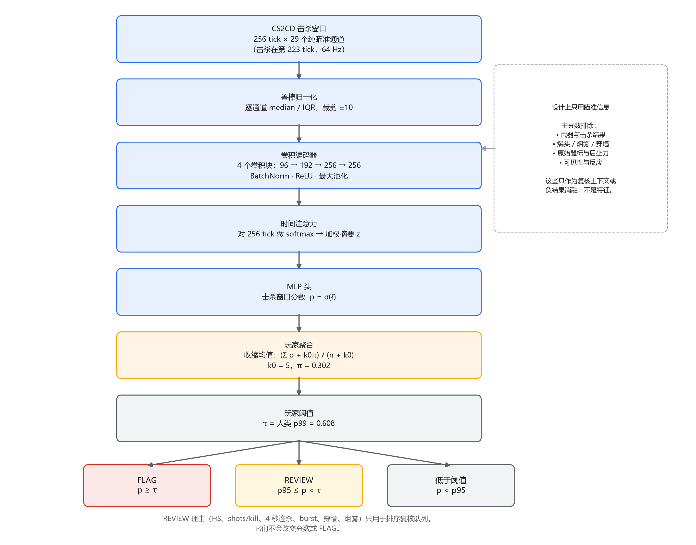
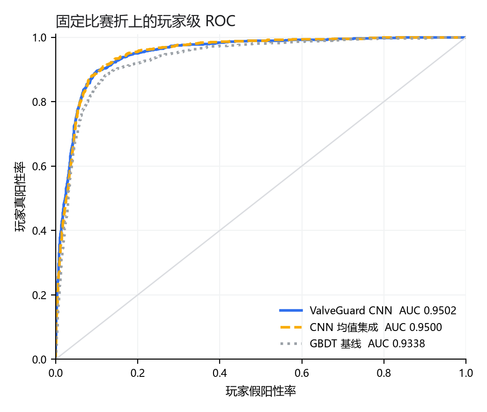
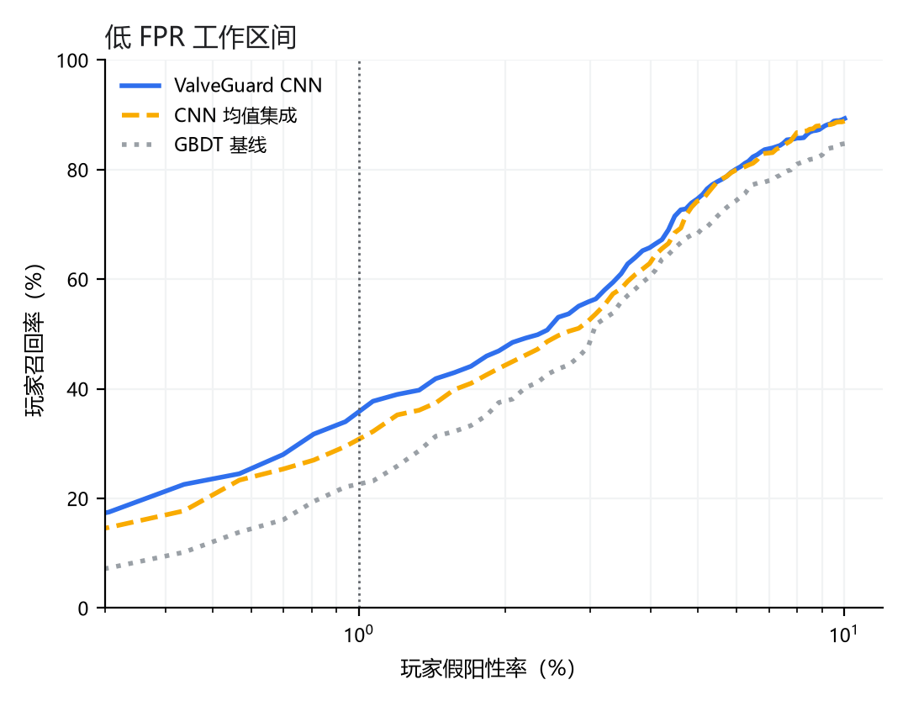
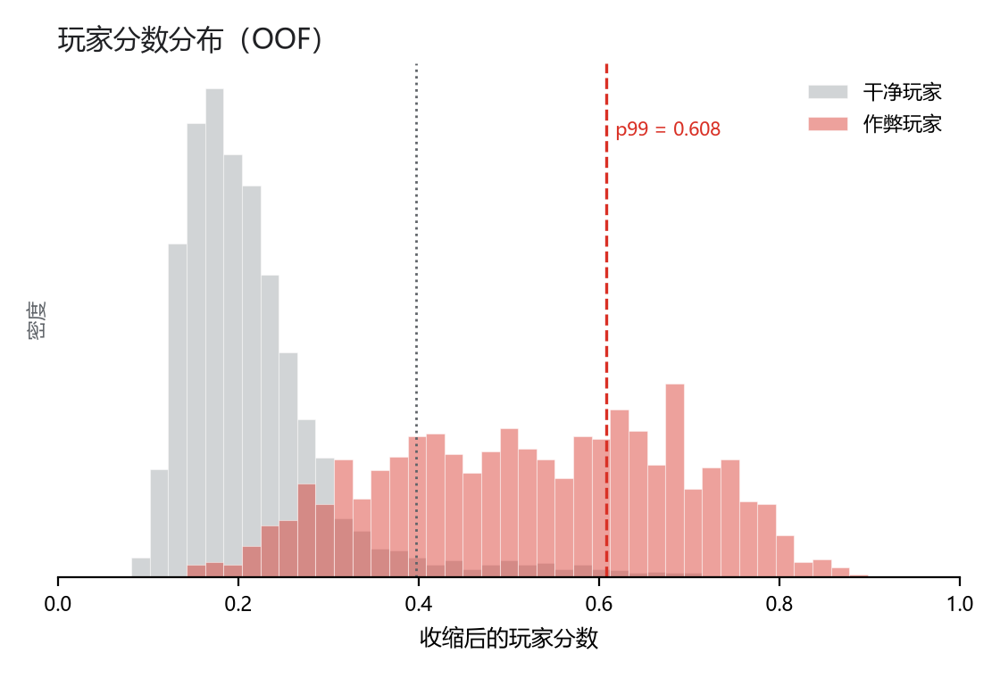
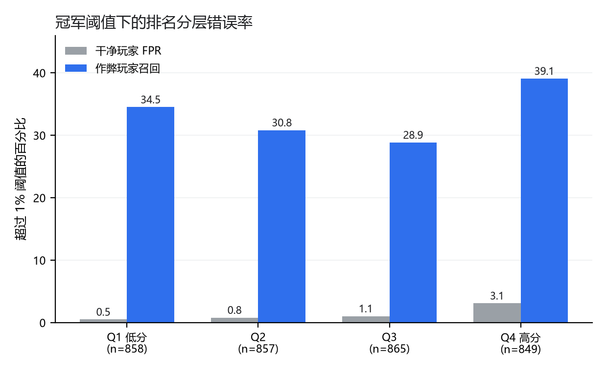
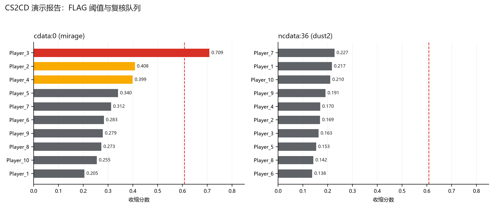
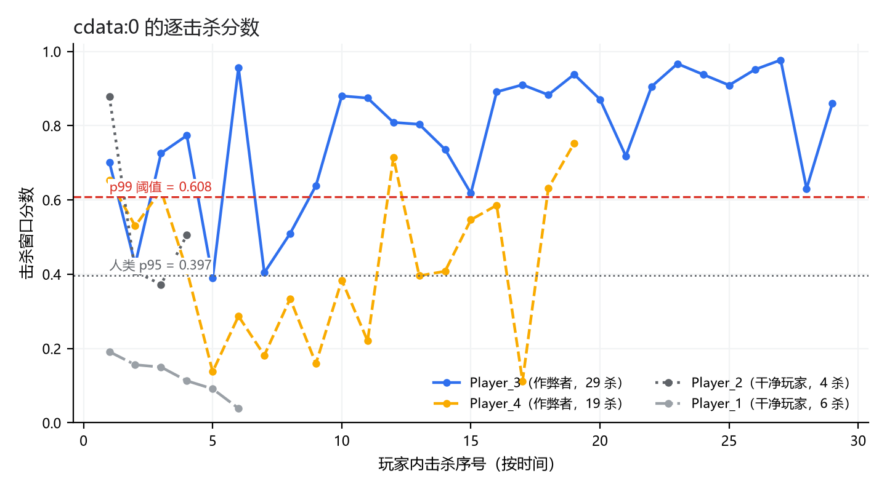
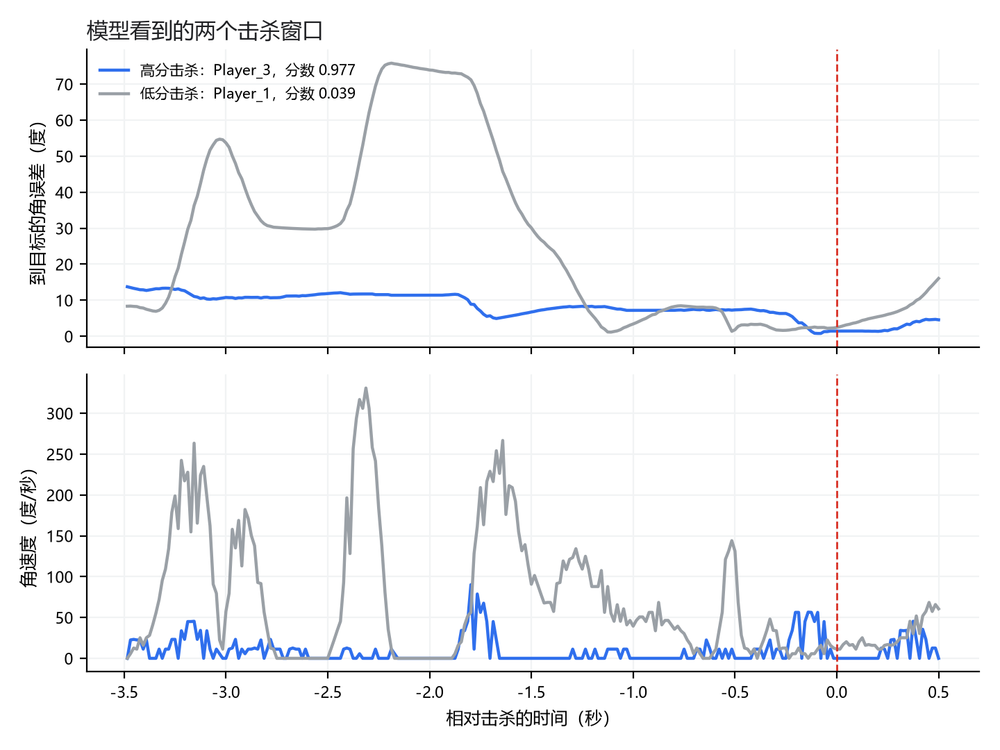

# ValveGuard：基于击杀窗口视线轨迹的 CS2 辅助瞄准检测

**作者**：ValveGuard Project  
**单位**：独立研究项目  
**日期**：2026-10-20  
**版本**：v1.0（最终稿）

> 英文版：[valveguard-paper-en.md](valveguard-paper-en.md)

## 摘要

辅助瞄准（aim assist）在 CS2 中留下的主要可观测痕迹，不是击杀结果，而是击杀前后数百毫秒内的视线轨迹：准星如何接近目标、何时减速、是否出现过冲与二次修正、目标移动时视线是否保持锁定。本文给出一套仅使用服务端 demo 的、可复现的检测流程：从 CS2CD 数据集的 256 tick 击杀窗口中提取 29 个纯瞄准通道，用宽卷积网络加时间注意力编码轨迹，以困难负样本加权 BCE 训练，再按击杀分数做经验贝叶斯收缩，得到玩家级风险分数。

在固定的 5 折比赛隔离划分上，最终模型（3 个随机种子 × 5 折，α=5）取得玩家级 AUC **0.9502**、1% 假阳性率下的召回 **0.3619**、Q4 高分段玩家 FPR **3.11%**、Q4 召回 **39.1%**、击杀级 AUC **0.9015**。相对 GBDT 基线，配对 bootstrap 的平均召回增益为 **+0.1223**（95% CI [0.0476, 0.1988]），AUC 增益 **+0.0165**（[0.0120, 0.0211]），Q4 FPR 变化 +0.0030（[-0.0090, 0.0161]）。相对未加困难负样本的同结构 3 种子集成，召回增益 **+0.0459**（[0.0048, 0.0883]），AUC 基本不变。

我们还报告了一系列负结果：原始鼠标/后坐力通道、可见性/反应通道、玩家级 MIL、行为结果融合、top-k 聚合都没有在低 FPR 下稳定超过当前方案。外部 XGUARDIAN 处理后数据存在严重的“窗口数量”混杂，不能用于公平验证。最后，我们把模型封装为可校验的 artifact，并实现基于 CS2CD 窗口的演示报告与人工复核队列。该队列中的行为理由只用于排序复核优先级，从不改变风险分数或 FLAG。

**关键词**：CS2；辅助瞄准检测；视线轨迹；低假阳性率；困难负样本；玩家级聚合；可解释复核

## 1 引言

第一人称射击游戏（如 Counter-Strike 2，CS2）中的辅助瞄准通过修改准星运动，使瞄准更接近目标 [5]。与透视、信息共享等作弊不同，辅助瞄准的核心证据存在于**瞄准动力学**中：人类瞄准通常包含加速、减速、过冲和修正，受目标距离、目标横向速度、武器与灵敏度影响；辅助瞄准则可能表现为异常平滑、异常早的减速、过强的目标锁定，或在目标改变方向时缺少人类式修正。

CS2 的服务端 demo 以约 64 Hz 记录玩家位置、视线角、武器、生命值等状态，但不包含 1000 Hz 的原始鼠标输入。因此可用的信号是**视线角轨迹**，而不是完整的鼠标轨迹。这既限制了高频抖动等信号的可见性，也决定了检测器必须在较低采样率下工作。

本文的目标不是构造一个“自动封禁器”，而是一个面向人工复核的**风险排序器**。这带来三个设计约束：

1. **低假阳性率优先。** 在玩家级 1% FPR 的 operating point 上评估，而不是只看准确率或全 AUC。
2. **只用瞄准信息。** 武器、击杀结果、爆头、烟雾等元数据可能形成数据集捷径，不能作为主分数。
3. **输出可复核。** 每个玩家要有分数、百分位、击杀窗口证据和行为上下文，供分析师决定是否进一步查看。

本文的贡献如下：

- 一套从 CS2CD 窗口到可部署 artifact 的完整、可复现流程，包括坐标反归一化、俯仰角符号校正、29 个纯瞄准通道和逐种子归一化。
- 一个宽卷积 + 时间注意力的窗口模型，以及针对低 FPR 的困难负样本加权 BCE；在固定折上相对 GBDT 和普通 CNN 集成均有显著提升。
- 一个玩家级经验贝叶斯收缩与阈值协议，以及比赛分组配对 bootstrap 的评估方法。
- 一个基于数据集的演示系统：无需外部 demo，直接对 CS2CD 比赛窗口生成报告、图表和复核队列。
- 对原始鼠标、可见性、玩家级 MIL、行为融合等方向的系统性负结果，说明在当前数据条件下“纯瞄准 + 困难负样本”是更可靠的路线。

## 2 相关工作

**XGuardian** 是当前最接近的 CS2 服务端辅助瞄准检测工作，使用击杀窗口中的 pitch/yaw 轨迹，报告了高准确率与较低 FPR。本文与其区别在于：我们强调玩家级 1% FPR 的 operating point、公开可复现的固定折协议、以及人工复核队列；同时明确报告外部数据审计中的混杂问题。

**GAN-Aimbots** 研究用条件 GAN 生成类人瞄准，并评估检测器。它说明“像人”与“不像人”的判别可以成为检测信号，但也提示生成器与检测器之间存在攻防循环。本文不涉及生成，只做防守侧检测。

**HAWK** 从人类行为建模的角度构建反作弊框架，强调行为一致性与可解释性。本文的行为上下文（爆头率、连杀、burst、击杀间隔）与其思路相近，但我们把行为信息严格限制在复核排序层，不进入风险分数。

**CS2CD** 提供了本文使用的 CS2 数据集。CS2CD 的窗口以击杀为中心，标签来自 VAC 封禁与人工复核；其非作弊玩家在同一局内的标签精度有限，因此本文只使用干净负样本，具体见第 3 节。

与上述工作相比，本文的定位是：**在公开数据上给出一个可复现、低 FPR、可解释、可演示的检测基线**，并诚实报告哪些方向没有奏效。

## 3 数据

### 3.1 CS2CD 击杀窗口

本文使用 CS2CD 的 `Context_window_256`，统计见表 1：

**表 1**：CS2CD `Context_window_256` 数据集统计。

| 项目 | 数值 |
|---|---|
| 窗口总数（未增强） | 90,707 |
| 比赛数 | 794 |
| 作弊窗口 / 非作弊窗口 | 18,423 / 72,284 |
| 干净训练与评估窗口 | 79,533 |
| 干净窗口对应比赛 / 玩家 | 793 / 5,868 |
| 含作弊者的比赛 | 316 |
| 纯干净比赛 | 478 |
| 窗口形状 | 256 × 44 |
| 击杀所在行 | 223（前 223 tick，后 32 tick） |
| 采样率 | 64 Hz |

每个窗口的标签来自目录（`cheater/` 或 `not_cheater/`）。文件名形如
`cdata-cheater-file_{match}-Player_{k}-kill_{i}.parquet`，其中 `Player_{k}` 是**每局独立**的伪匿名，不是稳定的 SteamID。因此本文只能做比赛隔离划分，不能声称玩家隔离（person-disjoint）评估。

### 3.2 标签清洗

作弊者比赛中的非作弊玩家窗口（`cdata` 且 `label=0`）标签精度有限，数据卡估计约 55.6%。本文将其全部排除，保留 79,533 个干净窗口。我们对该排除做了窗口级审计：被排除窗口的分数分布与干净人类接近，按一阶矩分解估计的作弊者混杂约 5.5%，未支持 55.6% 的说法；细节见仓库的 `label-noise-audit.md`。无论如何，排除它们是更保守的选择。

### 3.3 演示用比赛

演示不使用外部 demo，而是直接从数据集缓存取两局：

- `cdata:0`：Mirage，78 个击杀窗口，10 名玩家，其中 `Player_3` 与 `Player_4` 有作弊标签。
- `ncdata:36`：Dust2，232 个击杀窗口，10 名玩家，全部为干净标签。

这两局只用于展示报告与队列形态，不作为泛化指标；它们与 artifact 的训练折存在重叠。

## 4 方法

### 4.1 预处理与通道

对每个 256 tick 窗口，记第 $t$ 个 tick 的第 $c$ 个通道为 $x_{t,c}$。我们先把发布数据中的归一化坐标反归一化到地图坐标：

$$
X = X_{\min} + \tilde{X}(X_{\max}-X_{\min}),
$$

其中 $X_{\min}, X_{\max}$ 来自地图边界表。视线角由

$$
\theta_{\text{stored}} = 180\tilde{\theta}-90,\qquad
\psi_{\text{stored}} = 360\tilde{\psi}-180
$$

恢复，其中 $\theta$ 为 pitch，$\psi$ 为 yaw。

CS2 存储的 pitch 与几何期望方向相反。对目标相对位移 $(\Delta x,\Delta y,\Delta z)$，定义

$$
\theta_{\text{target}} = -\arctan\!\frac{\Delta z}{\sqrt{\Delta x^2+\Delta y^2}},
$$

则俯仰误差为

$$
e_{\theta} = \theta_{\text{stored}}-\theta_{\text{target}}.
$$

在样例击杀 tick 上，这一符号约定把原点相对误差从 6.38° 降到 0.24°。类似地，头部误差使用眼高修正后的目标方向。

最终输入是 29 个**纯瞄准**通道，分为五组：

| 组别 | 通道 |
|---|---|
| 位置与速度 | `attacker_X/Y/Z`, `attacker_vel`, `attacker_pitch`, `attacker_yaw`, `victim_X/Y/Z`, `victim_health`, `victim_noise` |
| 角速度与高阶动态 | `dyaw_dps`, `dpitch_dps`, `speed_dps`, `accel_dps2`, `jerk_dps3` |
| 目标相对误差 | `err_yaw`, `err_pitch`, `err_pitch_head`, `err_origin`, `err_head` |
| 距离与几何 | `dist_norm`, `dist`, `dist_rate` |
| 锁定与相对运动 | `expected_yaw_vel`, `actual_yaw_vel`, `victim_speed`, `attacker_speed`, `t_norm` |

武器、爆头、烟雾、穿墙、空中击杀、原始鼠标、可见性等通道**不进入主模型**。它们要么形成标签捷径，要么在 64 Hz 下没有稳定增益，见第 5.3 节。

对每个通道，使用训练样本的 median/IQR 做鲁棒归一化：

$$
\tilde{x}_{t,c}=\operatorname{clip}\!\left(\frac{x_{t,c}-m_c}{s_c},-10,10\right),
$$

其中 $m_c$ 为中位数，$s_c=Q_{75,c}-Q_{25,c}$，当 $s_c<10^{-6}$ 时置为 1。归一化参数按种子分别保存，推理时按通道名选择，避免通道顺序漂移。

### 4.2 网络结构

设输入为 $X\in\mathbb{R}^{256\times 29}$。网络先转置为 $29\times256$，经过四层一维卷积：

$$
29 \to 96 \to 192 \to 256 \to 256,
$$

卷积核分别为 7、5、3、3，每层接 BatchNorm 与 ReLU，前两层后接 $2\times$ 最大池化。得到时间表示

$$
H=[h_1,\dots,h_T]\in\mathbb{R}^{T\times256}.
$$

时间注意力为

$$
e_t=w_2^\top\tanh(W_1h_t),\qquad
a_t=\frac{\exp(e_t)}{\sum_{t'}\exp(e_{t'})},\qquad
z=\sum_{t=1}^{T}a_th_t.
$$

最后用两层 MLP 输出击杀窗口 logit：

$$
\ell=\mathrm{MLP}(z),\qquad p=\sigma(\ell).
$$

模型参数量为 **524,162**。图 1 给出整体流程。

<p align="center">
  
</p>

**图 1**：ValveGuard 的推理流程。左侧为窗口编码与玩家聚合，右侧注明主分数刻意排除的通道；行为上下文只参与复核排序，不进入分数。

### 4.3 困难负样本加权 BCE

数据中负样本远多于正样本。设训练集中负/正样本数为 $N_-,N_+$，正类权重为

$$
w_{\text{pos}}=\frac{N_-}{N_+}.
$$

对第 $i$ 个窗口，基础二元交叉熵为

$$
\ell_i=-\left[w_{\text{pos}}y_i\log p_i+(1-y_i)\log(1-p_i)\right].
$$

低 FPR 指标关心的是人类分数分布的**上尾**：一个被模型给出高分的干净窗口，比一个低分干净窗口更值得惩罚。因此对负样本乘上基于当前预测的权重：

$$
h_i=
\begin{cases}
1, & y_i=1,\\
1+\alpha\,\big(\sigma(\ell_i)\big)^2, & y_i=0,
\end{cases}
$$

其中 $\sigma(\ell_i)$ 在前向时 detach，避免损失把负样本分数直接推向 0 的退化。最终损失为

$$
\mathcal{L}=\frac{\sum_i h_i\ell_i}{\sum_i h_i}.
$$

主实验取 $\alpha=5$。我们比较了 $\alpha\in\{2,5,10\}$：$\alpha=10$ 的单种子召回略高（0.3479 vs 0.3440），但增益很小且更激进，因此保留 $\alpha=5$ 作为较温和的设置。这一做法与在线困难样本挖掘 [9] 和 focal loss [10] 相关，但我们的权重只作用于负样本，并基于当前预测而不是固定的难例集合。

### 4.4 玩家级聚合

对玩家 $i$ 的 $n_i$ 个击杀窗口，模型给出分数 $s_{i,j}=\sigma(\ell_{i,j})$。直接取均值会让只有 2–3 次击杀的玩家方差过大，因此使用经验贝叶斯收缩：

$$
\hat{s}_i=\frac{\sum_{j=1}^{n_i}s_{i,j}+k_0\pi}{n_i+k_0},
$$

其中 $k_0=5$，先验 $\pi=0.3018746$（训练集人类玩家平均分数）。当 $n_i$ 很小时，分数被拉向先验；当 $n_i$ 很大时，接近玩家自己的均值。

阈值取 OOF 人类玩家分数的第 99 百分位：

$$
\tau=Q_{0.99}\big(\{\hat{s}_i:y_i=0\}\big)=0.608027.
$$

若 $\hat{s}_i\ge\tau$ 则 FLAG；若 $\hat{s}_i$ 位于人类 p95 与 p99 之间则标为 REVIEW；否则为 below。REVIEW 是人工复核带，不是检测结论。

### 4.5 评估指标与统计

本文以**玩家级**指标为主，击杀级为辅：

- 玩家 AUC：以玩家分数区分作弊/干净玩家。
- Recall@FPR=1%：在干净玩家 1% 假阳性率对应的阈值下，作弊玩家的召回。
- Q4 FPR：在排名最高四分位（Q4）的干净玩家中，超过阈值的比例。
- Q4 Recall：在 Q4 作弊玩家中，超过阈值的比例。
- 击杀 AUC：窗口级排序能力。

FPR 与召回定义为

$$
\mathrm{FPR}(t)=\frac{1}{N_-}\sum_{i:y_i=0}\mathbf{1}[\hat{s}_i\ge t],\qquad
\mathrm{Recall}(t)=\frac{1}{N_+}\sum_{i:y_i=1}\mathbf{1}[\hat{s}_i\ge t].
$$

所有模型使用同一组固定的 5 折比赛划分（来自 `reports/cv_gbdt/cv_predictions.parquet`），每折内没有比赛重叠。三个随机种子使用相同折。ROC/AUC 的定义遵循 [7]。模型比较采用**比赛分组配对 bootstrap** [6]：以比赛为单位有放回重采样 500 次，每次重算两个模型的指标，报告差值分布的均值和 95% 百分位区间。这样可以保留同一比赛内玩家分数的相关性。

## 5 实验

### 5.1 基线

- **GBDT**：59 个手工窗口特征，`HistGradientBoostingClassifier`，300 棵树、31 叶、学习率 0.05、L2=1.0。这是项目早期的强基线。
- **普通 CNN 集成**：与最终模型相同的 29 通道与折划分，3 个种子 × 5 折，但不使用困难负样本加权。
- **ValveGuard CNN**：29 通道、宽卷积 + 时间注意力、3 种子 × 5 折、$\alpha=5$。这是最终模型。

### 5.2 主结果

主结果见表 2。

**表 2**：固定 5 折比赛划分上的主结果。

| 模型 | 击杀 AUC | 玩家 AUC | Recall@FPR=1% | Q4 FPR | Q4 Recall |
|---|---|---|---|---|---|
| GBDT | 0.8497 | 0.9338 | 0.2296 | **2.59%** | 22.9% |
| CNN 均值集成 | **0.9021** | 0.9500 | 0.3121 | **2.59%** | 33.9% |
| **ValveGuard CNN** | 0.9015 | **0.9502** | **0.3619** | 3.11% | **39.1%** |

配对 bootstrap：

- ValveGuard vs GBDT：$\Delta$击杀 AUC **+0.0519** [0.0470, 0.0568]；$\Delta$玩家 AUC **+0.0165** [0.0120, 0.0211]；$\Delta$Recall **+0.1223** [0.0476, 0.1988]；$\Delta$Q4 FPR +0.0030 [-0.0090, 0.0161]。
- ValveGuard vs 均值集成：$\Delta$Recall **+0.0459** [0.0048, 0.0883]；$\Delta$AUC +0.0002 [-0.0014, 0.0016]；$\Delta$Q4 FPR +0.0048 [-0.0057, 0.0158]。

表中是全 OOF 的点估计；bootstrap 报告的是重采样差值均值，因此与表中两个点估计的直接差值可能略有不同。困难负样本带来的召回增益是显著的，AUC 没有实质变化。Q4 FPR 从 2.59% 升到 3.11%，绝对值上是在 386 名干净 Q4 玩家中多了约 2 个假阳性，置信区间跨零；换取的是 Q4 召回从 33.9% 升到 39.1%。在“人工复核”的定位下，这个交换是合理的；在“自动封禁”的定位下则不应接受。

<p align="center">
  
</p>

**图 2**：玩家级 ROC。三条曲线使用相同的固定折与收缩聚合。

<p align="center">
  
</p>

**图 3**：低 FPR 区域。横轴为对数尺度的玩家 FPR，虚线为 1%。

<p align="center">
  
</p>

**图 4**：玩家分数分布与人类 p99 阈值。红色分布为作弊玩家，灰色为干净玩家。

<p align="center">
  
</p>

**图 5**：按排名四分位分层的错误率。Q4 的干净玩家 FPR 为 3.1%，明显高于低分段的 0.5%–1.1%。

### 5.3 消融与负结果

消融与负结果见表 3。

**表 3**：消融与负结果。原始通道与可见性通道在各自覆盖子集上评估，不能与主表逐项直接比较。

| 变体 | 玩家 AUC | Recall@FPR=1% | Q4 FPR | 结论 |
|---|---|---|---|---|
| Top-5 聚合 | 0.9277 | 0.3230 | 3.37% | 召回略升，AUC 与 Q4 FPR 变差；不作默认 |
| 玩家级 MIL（冻结编码器） | 0.9478 | 0.3175 | 5.44% | Q4 FPR 显著变差，拒绝 |
| 玩家级 MIL（解冻） | 0.9329 | 0.2856 | 3.63% | AUC 下降，拒绝 |
| 29 + 23 原始通道 | 0.9387 | 0.2770 | — | 击杀 AUC 仅 +0.0037，玩家级无增益 |
| 29 + 5 可见性/反应通道 | 0.9461 | 0.3136 | 3.13% | 击杀 AUC +0.0074，玩家级无增益 |
| 行为分数（仅结果特征） | 0.9196 | 0.1572 | 2.85% | 低 FPR 尾部不具作弊特异性 |
| 行为 rank fusion 0.75 | 0.9519 | 0.2887 | 3.11% | $\Delta$Recall -0.0554，拒绝 |

几点解释：

1. **Top-5 聚合**针对“只开几枪”的 toggle 作弊者，确实提高了少量召回，但牺牲了整体 AUC 与 Q4 FPR。均值收缩仍是更稳的默认。
2. **玩家级 MIL** 用 5,868 个玩家标签替代 79,533 个窗口标签，注意力池化方差过大；冻结编码器时 Q4 FPR 升到 5.44%，解冻后玩家 AUC 下降。
3. **原始鼠标/后坐力通道**在 64 Hz 下只带来很小的击杀级增益；玩家级 AUC 与召回没有稳定提升。鼠标—视角一致性已经被 29 个派生通道部分吸收。
4. **可见性/反应通道**提高了击杀级 AUC（+0.0074），但没有转化为低 FPR 玩家召回。近似 `approximate_spotted_by` 的可见性噪声较大，且正常预瞄会混淆。
5. **行为结果融合**的全局 AUC 很高，但 1% 尾部并不特异：行为分数单独使用时 Recall 只有 0.157；与瞄准分数做 rank fusion 会拉低低 FPR 召回。行为信息更适合做复核上下文，而不是排序分数。

### 5.4 外部数据审计

我们检查了 XGUARDIAN 的处理后 CSV。该数据每个玩家-matches 的窗口数量差异极大：作弊者平均 22.1 个窗口，人类平均 4.6 个。**仅用窗口数量**作为分数就能得到玩家 AUC 0.9705，高于任何特征模型。按窗口数分箱后模型 AUC 降到 0.44–0.68；每玩家采样 5 个窗口后窗口 AUC 为 0.743。CS2CD 上同样的“窗口数”基线只有玩家 AUC 0.499，说明这不是本文数据的普遍问题，而是 XGUARDIAN 处理后样本的采集偏差。因此我们没有把它当作外部验证集，也不引用其上的检测指标作为结论。

## 6 演示系统

### 6.1 报告内容

`demo_report_dataset.py` 从数据集缓存中取一局或多局比赛，按通道名选择 29 个瞄准通道，加载 15 个折模型，输出：

- `result.json`：每个玩家的分数、百分位、tier、击杀数与行为上下文；
- `review_queue.csv`：按复核优先级排序的玩家列表；
- `players.png`：玩家分数与人类分布；
- `kill_windows.png`：每个玩家的击杀窗口分数；
- `behavior.png`：HS%、shots/kill、4 秒连杀、burst、击杀间隔、狙击占比；
- 根目录的 `review_queue.csv` 与 `summary.json`：多局合并队列。

### 6.2 复核队列规则

排序规则是：

1. FLAG 玩家最前；
2. REVIEW 玩家按行为理由数量降序，再按瞄准分数降序；
3. below 玩家按瞄准分数降序。

行为理由包括：HS ≥ 80%、≤1.5 shots/kill、狙击爆头、穿墙 ≥20%、烟雾 ≥20%、4 秒内 ≥3 杀、burst ≥30%。这些理由**只影响队列顺序**，不改变分数、阈值或 FLAG。这样做的原因是：行为特征在全局上有区分度，但在 1% 尾部不够特异；把它作为排序信号比作为检测信号更安全。

### 6.3 数据集演示

演示玩家见表 4 与图 6。

<p align="center">
  
</p>

**图 6**：两局 CS2CD 比赛的玩家分数。左：`cdata:0`，右：`ncdata:36`。红色为 FLAG，橙色为 REVIEW，灰色为 below；虚线为人类 p99 阈值。

**表 4**：演示比赛的代表性玩家分数与行为上下文。标签仅用于演示核对，不参与推理。

| 比赛 | 玩家 | 标签 | 击杀 | HS% | Shots/K | 4s 连杀 | Burst% | 分数 | Tier | 理由数 |
|---|---|---|---|---|---|---|---|---|---|---|
| cdata:0 | Player_3 | 1 | 29 | 96.6 | 1.86 | 4 | 35.7 | **0.709** | FLAG | 4 |
| cdata:0 | Player_2 | 0 | 4 | 50.0 | 0.75 | 1 | 0.0 | 0.408 | REVIEW | 2 |
| cdata:0 | Player_4 | 1 | 19 | 42.1 | 1.32 | 2 | 11.1 | 0.399 | REVIEW | 1 |
| ncdata:36 | Player_7 | 0 | 26 | 46.2 | 1.77 | 2 | 8.0 | 0.227 | below | 0 |

这组演示说明三件事：

1. 主作弊者 `Player_3` 在严格阈值上被 FLAG，行为上下文（HS 96.6%、1.86 shots/kill、4 连杀、burst 35.7%）与高分一致。
2. 第二名有标签作弊者 `Player_4` 没有被 FLAG，只进入 REVIEW。这是 1% 严格阈值下的真实漏检，不应被演示结果掩盖。
3. 干净玩家 `Player_2` 因行为理由（HS 50%、0.75 shots/kill）排到了 `Player_4` 前面。这说明行为理由不是证据，只是复核排序；FLAG 仍由瞄准分数决定。

干净比赛 `ncdata:36` 的 10 名玩家全部低于人类 p95，最高分 0.227（p67.5），没有 FLAG 或 REVIEW。该演示与训练折重叠，分数只用于展示流程，不作为泛化指标。

## 7 处理示例：一局比赛的端到端流程

本节把 `cdata:0` 完整走一遍，展示从“把一局对局扔进去”到“得到复核队列”的每一步。示例只用于说明数据流和输出形态，不构成泛化指标。

### 7.1 输入与命令

输入是一局 CS2CD 比赛 `cdata:0`（Mirage），包含 10 名玩家、78 个击杀窗口。运行：

```bash
PYTHONPATH=src python -m valveguard.scripts.demo_report_dataset \
  --match cdata:0 --out reports/demo_dataset
```

脚本读取缓存的窗口索引、43 通道张量、击杀 tick 映射和打包 artifact，写出 `result.json`、`review_queue.csv` 与三张报告图。输出摘要如下：

```json
{
  "source": "CS2CD",
  "match": "cdata:0",
  "map": "mirage",
  "threshold": 0.608027,
  "players": [
    {"player": "Player_3", "dataset_label": 1, "tier": "flag",
     "kills": 29, "mean_score": 0.779114, "max_kill_score": 0.976842,
     "shrunk_score": 0.708932, "percentile": 99.8,
     "review_reasons": ["HS>=80%", "smoke>=20%", "4s multikill>=3", "burst>=30%"]}
  ]
}
```

**清单 1**：`cdata:0` 的 `result.json` 摘要（省略其余玩家与逐击杀分数）。

### 7.2 中间张量与玩家聚合

表 5 给出每一步的实际规模。窗口缓存保留 43 个通道，模型按通道名选择其中 29 个，因此通道顺序变化不会影响推理。归一化参数按种子分别保存；15 个折模型（3 种子 × 5 折）对同一批窗口打分后取平均。

**表 5**：`cdata:0` 的端到端处理步骤。

| 步骤 | 操作 | 输出 / 形状 |
|---|---|---|
| 1 | 从索引中筛选比赛 | 78 行 × 11 列，10 名玩家 |
| 2 | 按 `row` 切片通道缓存 | 78 × 256 × 43，float16 |
| 3 | 按通道名选择 29 个纯瞄准通道 | 78 × 256 × 29 |
| 4 | 逐种子 median/IQR 归一化并裁剪 | 78 × 256 × 29，float32 |
| 5 | 15 个折模型打分并平均 | 78 个击杀分数，∈[0,1] |
| 6 | 玩家级收缩聚合 | 10 行：$n_i$、均值、收缩分数 |
| 7 | p99 阈值与行为上下文 | 1 FLAG、2 REVIEW、7 below；复核队列 |

聚合公式的直接效果可以在三名玩家身上看到：

- `Player_3`：29 次击杀，均值 0.779，收缩后 **0.709**；
- `Player_4`：19 次击杀，均值 0.425，收缩后 **0.399**；
- `Player_2`（干净标签）：4 次击杀，均值 0.541，但收缩后只有 **0.408**。

`Player_2` 有一次 0.878 的高分击杀，如果按单次击杀或 top-1 排序会被放大；收缩把 4 次击杀的估计拉向人类先验 0.302，因此它进入 REVIEW 而不是 FLAG。`Player_4` 的击杀数足够多，收缩影响较小，但其均值本身低于阈值，所以也没有 FLAG。这个例子说明了为什么我们使用收缩均值而不是最大击杀分数。

**表 6**：`cdata:0` 的完整玩家输出（按复核队列排序）。

| # | 玩家 | 标签 | 击杀 | 均值 | 最大 | 收缩分数 | 百分位 | Tier | 理由 |
|---|---|---|---|---|---|---|---|---|---|
| 1 | Player_3 | 1 | 29 | 0.779 | 0.977 | **0.709** | 99.8 | FLAG | HS, smoke, multi4, burst |
| 2 | Player_2 | 0 | 4 | 0.541 | 0.878 | 0.408 | 95.3 | REVIEW | eff, wall |
| 3 | Player_4 | 1 | 19 | 0.425 | 0.753 | 0.399 | 95.1 | REVIEW | eff |
| 4 | Player_5 | 0 | 5 | 0.379 | 0.710 | 0.340 | 92.7 | below | multi4, burst |
| 5 | Player_7 | 0 | 2 | 0.338 | 0.445 | 0.312 | 90.6 | below | — |
| 6 | Player_6 | 0 | 2 | 0.236 | 0.239 | 0.283 | 85.9 | below | — |
| 7 | Player_9 | 0 | 7 | 0.263 | 0.494 | 0.279 | 85.1 | below | — |
| 8 | Player_8 | 0 | 2 | 0.201 | 0.291 | 0.273 | 83.7 | below | — |
| 9 | Player_10 | 0 | 2 | 0.137 | 0.143 | 0.255 | 78.5 | below | — |
| 10 | Player_1 | 0 | 6 | 0.123 | 0.191 | 0.205 | 54.7 | below | — |

理由代码：`HS`=爆头率 ≥80%，`eff`=≤1.5 shots/kill，`multi4`=4 秒内 ≥3 杀，`burst`=burst ≥30%，`wall`=穿墙 ≥20%，`smoke`=烟雾 ≥20%。完整文本在 `review_queue.csv` 中。

### 7.3 逐击杀分数与窗口视图

图 7 展示四名玩家的逐击杀分数。`Player_3` 的分数在大部分击杀上高于 p99 阈值；`Player_4` 的分数在阈值上下波动，最终均值不足以 FLAG；两名干净玩家整体较低，但 `Player_2` 仍有一次高分击杀。玩家级分数不是某一次击杀，而是整条序列的收缩均值。

<p align="center">
  
</p>

**图 7**：`cdata:0` 的逐击杀分数。点线与虚线分别为人类 p95 与 p99 阈值。

图 8 进一步展示模型实际看到的两个窗口：一个高分击杀（`Player_3`，0.977）和一个低分击杀（`Player_1`，0.039）。上图为到目标的角误差，下图为角速度；虚线为击杀 tick。高分窗口在击杀前保持较低误差、较少剧烈修正；低分窗口在击杀前出现较大的角误差与多次高速修正。这里只做可视化说明；模型使用的是完整的 29 通道轨迹，而不是单一误差阈值。

<p align="center">
  
</p>

**图 8**：两个击杀窗口的角误差与角速度。红色虚线为击杀 tick（相对时间 0）。

## 8 讨论

**为什么困难负样本有效。** 普通 BCE 对所有负样本一视同仁，模型会把大量“容易的人类”压低，但对少数高分人类窗口惩罚不足。低 FPR 指标只看人类分布的上尾，因此按当前预测给负样本加权，等价于把优化目标往“压住高分人类”倾斜。实验中召回从 0.3121 升到 0.3619，AUC 不变，符合这一机制。

**为什么坚持纯瞄准。** 元数据模型（地图、武器、击杀结果）在早期实验中可以取得很高的 AUC，但这是数据集采集方式的捷径，不是辅助瞄准的因果信号。原始鼠标通道在 64 Hz 下没有稳定玩家级增益，说明派生几何/动力学通道已经覆盖了大部分可用信息。行为结果在全局 AUC 上很强，但在 1% 尾部不特异，因此只能做复核上下文。

**Q4 的代价。** 高分段人类的瞄准更接近“机器般平滑”，这是检测器的主要假阳性来源。最终模型在 Q4 干净玩家上的 FPR 是 3.11%，高于低分段的 0.5%–1.1%。我们没有用排名作为特征或做分组阈值，因为那会进一步抬高 Q4 FPR 或破坏全局阈值语义。当前的做法是：接受 Q4 的额外复核负担，用人工复核而不是自动封禁来消化。

**外部有效性。** XGUARDIAN 处理后数据的窗口数混杂提醒我们：不同数据集的采集协议会制造强捷径。任何跨数据集结论都必须先检查“每玩家窗口数/活动量”这类基线。本文的 CS2CD 对照显示该混杂不成立，但这不等于模型可以无条件迁移到其他平台。

## 9 局限与伦理

**技术局限。**

- 64 Hz 视线角，不是 1000 Hz 原始鼠标；高频抖动、微修正等信息不可见。
- 分数是风险排序分数，不是校准概率（玩家级 ECE 约 0.18）[8]；本文没有把校准作为低 FPR 的修复手段。
- 只有比赛隔离划分，CS2CD 的玩家 ID 是每局伪匿名，无法做真正的 person-disjoint 评估或跨比赛身份追踪。
- 标签来自 VAC 封禁与人工复核，存在漏标；作弊者比赛中的非作弊玩家标签精度有限，本文选择排除。
- 可见性使用近似 team-spotted 标记，没有 raycast；预瞄与正常架枪会混淆。
- 演示比赛与训练折重叠，演示分数不是 held-out 指标。

**使用边界。**

- 本文模型是**风险排序器**，不是自动封禁系统；任何处置都应由人工复核。
- 只用于服务端 demo 的事后分析；不涉及实时注入、客户端修改、反反作弊或任何规避检测的技术。
- 不用于跨游戏、跨平台的身份追踪；不把分数当作“作弊概率”。
- 数据集遵循 CS2CD 的 CC-BY-4.0 许可；演示报告只使用数据集伪匿名，不包含真实 SteamID 或昵称。

## 10 复现

环境：Python 3.12，PyTorch 2.9（CUDA 12.8），NumPy/Pandas/scikit-learn。

```bash
# 测试（12 passed）
python -I -m pytest -q tests

# 数据集演示：两局比赛 + 合并复核队列
PYTHONPATH=src python -m valveguard.scripts.demo_report_dataset \
  --match cdata:0 --match ncdata:36 --out reports/demo_dataset

# 重新生成论文图
PYTHONPATH=src python -m valveguard.scripts.make_paper_figures
```

关键文件：

| 路径 | 内容 |
|---|---|
| `artifacts/valveguard_cnn_v1/` | 打包 artifact（本地，不跟踪）：manifest、通道名、归一化、15 个折模型、人类参考分布、校验和 |
| `src/valveguard/models/artifact.py` | 校验、按名选通道、逐种子归一化、15 模型平均、玩家聚合 |
| `src/valveguard/scripts/train_channel_cnn.py` | 宽 CNN、固定折、困难负样本损失、模型保存 |
| `src/valveguard/scripts/demo_report_dataset.py` | 数据集演示报告 |
| `src/valveguard/scripts/demo_report.py` | 任意 demo 报告与批量队列 |
| `reports/cnn29_hn5_ensemble_vs_gbdt/comparison.json` | 主比较与 bootstrap |
| `reports/demo_dataset/` | `cdata:0` 与 `ncdata:36` 的报告、队列与图表 |
| `src/valveguard/scripts/make_paper_figures.py` | 论文图 1–8 的生成脚本 |
| `reports/paper_figures/` | 本文图 1–8 |

所有实验记录、负结果和修正见 `docs/llmwiki/experiments.md` 与 `docs/llmwiki/changelog.md`。

### 10.1 数据与代码可用性

CS2CD `Context_window_256` 为公开数据集，许可为 CC-BY-4.0。本文的代码、配置、演示报告、论文图和任务记录均在本仓库中；`artifacts/valveguard_cnn_v1` 是本地打包产物，不随仓库跟踪，但可由保存的折模型、归一化参数和 manifest 重新构建。演示只使用数据集伪匿名，不包含真实 SteamID 或昵称。

## 11 结论

本文给出了一个仅依赖击杀窗口视线轨迹的 CS2 辅助瞄准检测器。通过 29 个纯瞄准通道、宽卷积 + 时间注意力、困难负样本加权 BCE 与玩家级经验贝叶斯收缩，模型在固定比赛折上取得玩家级 AUC 0.9502、1% FPR 下召回 0.3619、Q4 召回 39.1%。相对 GBDT 与普通 CNN 集成，召回提升显著且 AUC 不降；代价是 Q4 FPR 从 2.59% 升到 3.11%。

负结果同样重要：原始鼠标、可见性、玩家级 MIL、行为融合都没有在低 FPR 下稳定超过当前方案。行为信息被保留为人工复核的排序上下文，而不是风险分数。最终系统以数据集窗口为演示来源，输出可追溯的 artifact、玩家报告和复核队列，适合作为后续数据采集与人工复核流程的基线。

## 附录 A：符号表

**表 7**：本文主要符号。

| 符号 | 含义 |
|---|---|
| $X$ | 一个 256 tick × 29 通道的击杀窗口 |
| $x_{t,c}$ | 第 $t$ 个 tick、第 $c$ 个通道的原始值 |
| $m_c, s_c$ | 通道 $c$ 的训练中位数与 IQR |
| $H, h_t$ | 卷积编码后的时间表示 |
| $a_t$ | 时间注意力权重 |
| $z$ | 注意力加权后的窗口表示 |
| $\ell, p$ | 击杀窗口 logit 与 sigmoid 分数 |
| $s_{i,j}$ | 玩家 $i$ 第 $j$ 次击杀的分数 |
| $n_i$ | 玩家 $i$ 的击杀窗口数 |
| $k_0, \pi$ | 收缩强度与人类先验分数 |
| $\hat{s}_i$ | 玩家 $i$ 的收缩分数 |
| $\tau$ | 玩家级 p99 阈值 |
| Q4 | 排名最高四分位 |

## 参考文献

1. CS2CD. *Context_window_256* [Dataset]. Hugging Face, CC-BY-4.0. https://huggingface.co/datasets/CS2CD/Context_window_256
2. Zhang et al. *XGuardian: Towards Generalized, Explainable and More Effective Server-side Anti-cheat in First-Person Shooter Games*. USENIX Security '26. https://www.usenix.org/conference/usenixsecurity26/presentation/zhang-jiayi
3. Kanervisto et al. *GAN-Aimbots: Using Machine Learning for Cheating in First Person Shooters*. IEEE Transactions on Games, 2022. https://arxiv.org/abs/2205.07060
4. *Identify As A Human Does: A Pathfinder of Next-Generation Anti-Cheat Framework for First-Person Shooter Games* (HAWK). arXiv:2409.14830. https://arxiv.org/abs/2409.14830
5. Valve Corporation. *Counter-Strike 2*. 2023.
6. B. Efron and R. J. Tibshirani. *An Introduction to the Bootstrap*. Chapman & Hall, 1993.
7. T. Fawcett. *An Introduction to ROC Analysis*. Pattern Recognition Letters, 27(8):861–874, 2006.
8. C. Guo, G. Pleiss, Y. Sun, and K. Q. Weinberger. *On Calibration of Modern Neural Networks*. ICML, 2017.
9. A. Shrivastava, A. Gupta, and R. Girshick. *Training Region-based Object Detectors with Online Hard Example Mining*. CVPR, 2016.
10. T.-Y. Lin, P. Goyal, R. Girshick, K. He, and P. Dollár. *Focal Loss for Dense Object Detection*. ICCV, 2017.
